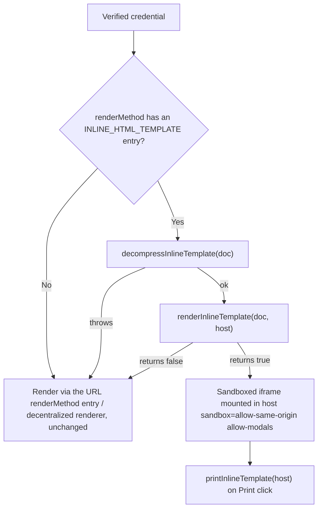

# Inline HTML Renderer Overview

The inline HTML renderer lets a W3C Verifiable Credential carry its own rendering template — HTML and CSS — directly inside the signed document, instead of pointing at a renderer page hosted elsewhere. A viewer fills that markup against the credential's `credentialSubject` and displays it, entirely offline, with no request to a renderer URL.

## Key Concepts

| Term                          | Description                                                                                                                            |
| ----------------------------- | -------------------------------------------------------------------------------------------------------------------------------------- |
| **`INLINE_HTML_TEMPLATE`**    | The `renderMethod` entry type that carries the template                                                                                |
| **Compressed template**       | The signed form: `base64url(gzip(JSON.stringify({ templateName, html, css })))`                                                        |
| **Binding attributes**        | `data-field`, `data-field-src`, `data-repeat` — how the template's markup pulls in credential data                                     |
| **Sandboxed `srcdoc` iframe** | Where the filled template is mounted; the only place it is ever shown                                                                  |
| **Fallback renderer**         | The existing URL-based `renderMethod` entry (e.g. `EMBEDDED_RENDERER`), used whenever there's no inline template or it fails to render |

## Inline Template vs. Decentralized Renderer

|                                   | Decentralized renderer                                          | Inline template                                                                                |
| --------------------------------- | --------------------------------------------------------------- | ---------------------------------------------------------------------------------------------- |
| Where the template lives          | A website the issuer hosts, named by a URL `renderMethod` entry | Inside the credential itself                                                                   |
| Network needed to render          | Yes — the renderer page loads in an iframe                      | No — renders fully offline                                                                     |
| Covered by the credential's proof | Only the URL, not the page behind it                            | Yes — the HTML and CSS are part of the signed document                                         |
| Template logic                    | Arbitrary JavaScript (a React app)                              | Declarative HTML with `data-field` / `data-field-src` / `data-repeat` bindings; no scripts run |
| Template catalog                  | A fixed set of templates the renderer exposes                   | Any HTML and CSS you write, embedded directly — see [Using Any Template](./using-any-template) |
| Multiple views (tabs)             | Yes, the renderer reports its available templates               | One view per credential                                                                        |

A credential usually carries both entries side by side. A viewer that understands inline templates renders the inline one; everything else — an older viewer, or a failed inline render — falls back to the URL entry exactly as before.

## Architecture and Rendering Flow

Unlike the decentralized renderer (a cross-origin iframe talking to the host over `postMessage`), the inline template never leaves the viewer's own process: the SDK parses the template with `DOMParser`, fills it against `credentialSubject`, and mounts the result as a sandboxed `srcdoc` iframe. There is no second application to load.

### How It Works

1. **Detect.** `getRenderMethods(doc)` reads the credential's `renderMethod` (array, or a single object in older documents) and returns the inline entry and the URL fallback, found by type regardless of order. No inline entry means the existing renderer runs, completely unchanged.
2. **Decompress.** `decompressInlineTemplate(doc)` restores the compressed string back to `{ templateName, html, css }`. This must run on the **verified** document — it returns a copy and never mutates its input, because the proof covers the compressed form.
3. **Build and fill.** Internally, the template's HTML is parsed with `DOMParser` into a detached document (so nothing in it can execute), and its `data-field` / `data-field-src` / `data-repeat` attributes are filled against `credentialSubject`.
4. **Mount.** `renderInlineTemplate(doc, host)` mounts the filled result as a sandboxed `<iframe srcdoc>` inside `host`, with a strict Content Security Policy. It returns `true` once mounted.
5. **Fall back.** If decompression throws, or `renderInlineTemplate` returns `false`, the viewer renders the URL `renderMethod` entry with the existing decentralized renderer instead — the same experience as a document that never had an inline template.
6. **Print.** `printInlineTemplate(host)` finds the mounted iframe and calls its own `print()`, so only the template prints — not the surrounding page. It must be called from a user gesture (e.g. a Print button's click handler).

## Security Model

Template HTML is issuer-controlled and treated as hostile: it is shown only inside a sandboxed iframe, never in the viewer page's own DOM.

- **Sandbox:** `allow-same-origin allow-modals` — deliberately **no** `allow-scripts`, so nothing in the frame can run: no `<script>`, no `onerror=` / `onload=` handlers, no `javascript:` links.
- **CSP:** `default-src 'none'; img-src data:; font-src data:; style-src 'unsafe-inline'; form-action 'none'` — only `data:` images/fonts and inline styles are allowed; nothing remote can load.
- **Never `innerHTML`, `dangerouslySetInnerHTML` or Shadow DOM** — a Shadow DOM is not a security boundary. Render only through `renderInlineTemplate`.
- Decompress and render only **after** verification, on the verified document.

:::note Not for OpenAttestation documents
Inline HTML templates are a W3C Verifiable Credential feature: the `INLINE_HTML_TEMPLATE` entry is defined by the `renderMethod` JSON-LD context (`https://trustvc.io/context/render-method-context-v2.json`) that only W3C VC documents use. OpenAttestation documents — whether the legacy `$template` field or an OA v2/v3 `renderMethod` array pointing at a URL — do not support an inline entry and are unaffected by this feature. For OpenAttestation documents, continue to use a [decentralized renderer](/docs/how-tos/decentralized-renderer/decentralized-renderer-guide) or the [generic templates](/docs/how-tos/decentralized-renderer/using-generic-templates).
:::

## Next Steps

- [Using Any Template](./using-any-template) — write and attach your own HTML/CSS template to a document
- [Inline HTML Renderer Tutorial](/docs/tutorial/inline-html-renderer) — a full step-by-step walkthrough: issue a credential with an inline template, then verify, render and print it
